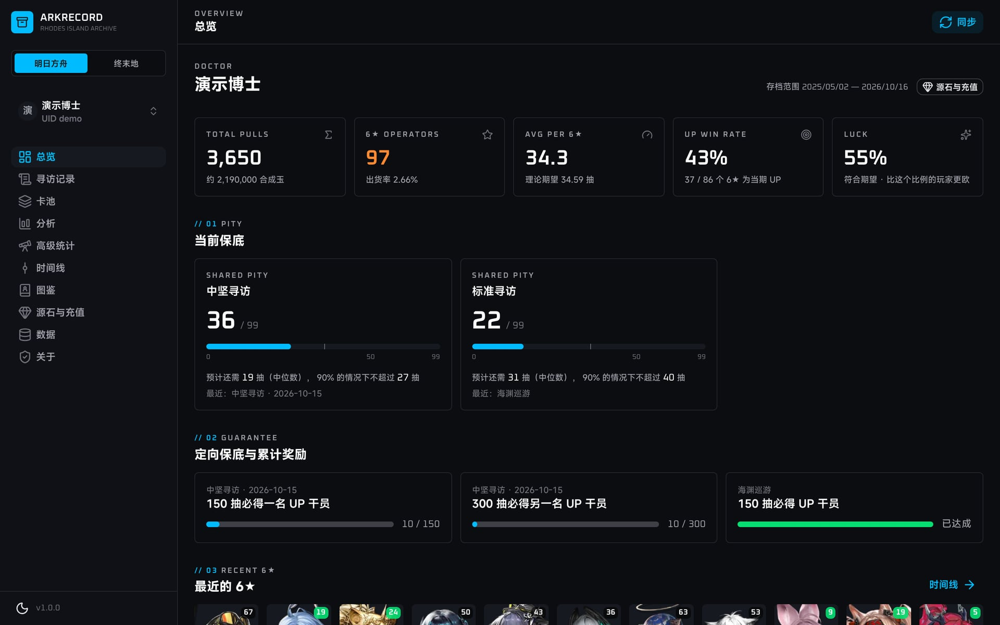
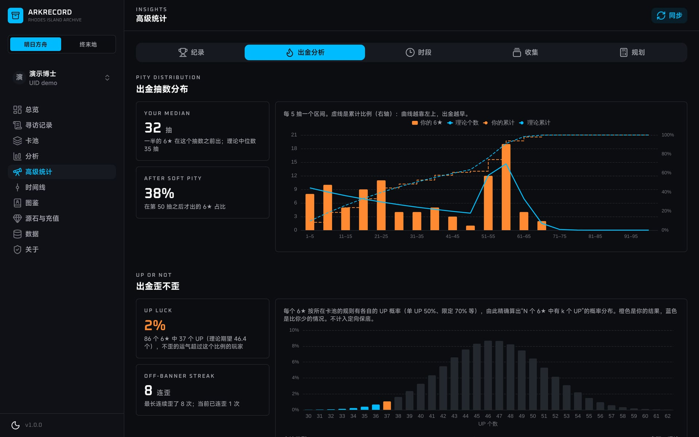
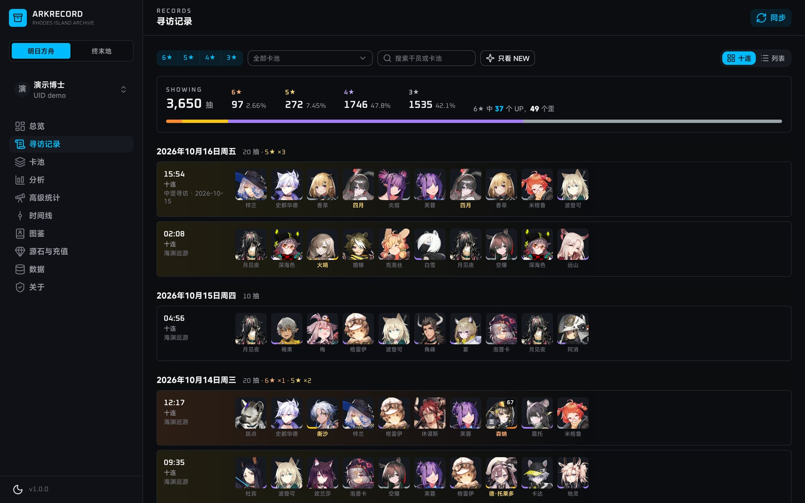
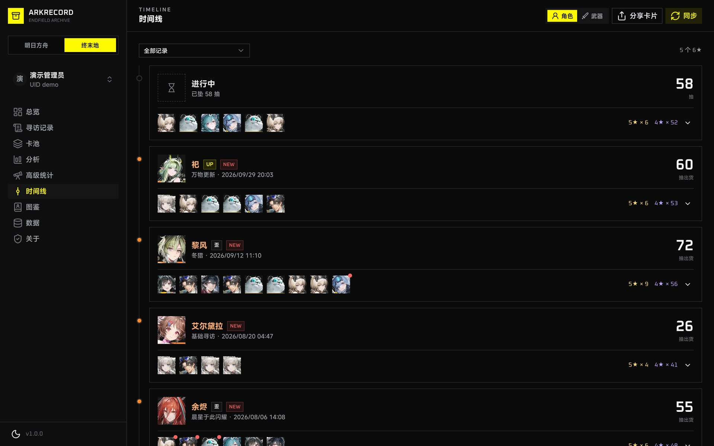

# ArkRecord

明日方舟 / 明日方舟：终末地 寻访记录的本地存档与分析工具。

**网站：<https://ark.kaltsit.dev>** · 当前版本 1.1.7 · 旧版：<https://ark.kaltsit.dev/legacy/>

鹰角官方只能查询最近 90 天的寻访记录（源石、充值记录只有 30 天）。ArkRecord 把每次同步到的记录追加保存在你自己的浏览器里，越攒越全，所有统计分析也都在浏览器本地完成。

> 1.0 是全新重写的版本（旧版为 2022–2023 年的 v0.1.0.1_alpha，代码在 [`legacy-v0.1`](https://github.com/DuskXi/ArkRecord-Web/tree/legacy-v0.1) 分支，旧版的 README 见 [docs/archive/README-v0.1.md](docs/archive/README-v0.1.md)）。
> 老用户第一次打开新版时，旧数据会自动导入；遇到问题可以在旧版网页里手动导出，再到新版导入，见[从旧版迁移](#从旧版迁移)。

**1.1 新增：加密云同步（可选）。**在多个浏览器、多台设备之间合并同一个账号的记录，数据在浏览器里用你的密码加密后才上传，服务器解不开。见[云同步](#云同步)。

## 截图

<table>
  <tr>
    <td width="50%"><br><sub>总览：当前保底、预计还需抽数、定向保底与累计奖励</sub></td>
    <td width="50%"><br><sub>高级统计：出金抽数分布、歪不歪的概率分布（精确计算）</sub></td>
  </tr>
  <tr>
    <td width="50%"><br><sub>寻访记录：按十连分组，高星级染色，保底与歪 / UP 标记</sub></td>
    <td width="50%"><br><sub>终末地：以 6★ 分段的时间线，角色池与武器池分开</sub></td>
  </tr>
</table>

<sub>截图使用演示 / 模拟数据。</sub>

## 快速开始

1. 在浏览器里登录 [鹰角网络通行证](https://user.hypergryph.com/)。B 服玩家需要先在通行证里绑定游戏角色。
2. 打开 [web-api.hypergryph.com/account/info/hg](https://web-api.hypergryph.com/account/info/hg)，复制页面上的全部内容。
3. 在 ArkRecord 点“添加账号”，粘贴进去，选择要添加的角色（明日方舟和终末地用同一个通行证）。
4. 点右上角的“同步”。之后**至少每个月同步一次**，就不会因为官方只保留 90 天（源石、充值 30 天）而漏掉记录。

不想登录的话，可以在“数据”页载入演示数据，先看看各个页面。

## 云同步

可选功能，在“数据”页按账号开通。适合在多个浏览器、电脑和手机之间看同一个账号的记录。

- **开通**：设置一个云同步密码（至少 12 位，可以点“生成”），记录在浏览器里加密后上传。开通时要用鹰角 token 证明账号是你的。
- **在别的设备上取回**：在“数据”页点“从云端恢复账号”，输入 UID 和云同步密码，记录会下载并和本地合并；之后每次点“云同步”都会双向合并。
- **检测云端状态**：不确定某个账号有没有在别处开通、开了哪种验证，可以点“检测云端状态”。
- **同步配置**：在一台设备上保存后，这台设备上的其他账号（同一个通行证下的另一个游戏、另一个服务器的角色）点一下就能开通或启用。配置只存在这台设备上，不会同步到别的设备。
- **鹰角 token 双重验证（可选）**：开启后，只知道 UID 和密码也取不回数据。
- **无密码模式（可选，不推荐）**：不用记密码，每次云同步都用鹰角 token 证明账号是你的，新设备上用鹰角登录就能连接。当前实现中，token 只在服务器核实请求时存在于内存里，不会出现在日志和硬盘里，代码公开接受审计（见 [SECURITY.md](SECURITY.md)）；代价是本站运营者和拿到你有效鹰角 token 的人技术上能读取你的云端记录（开通前会列出保护范围请你确认）。随时可以切回密码模式。
- **用到鹰角 token 时一定会先问你**：检测、开通、双重验证都要把鹰角 token 发给服务器核实账号归属。只有你点击按钮、并在确认窗口里点“确认发送”之后才会发送；服务器只在内存里用它查询角色绑定列表，核实完立即丢弃。
- **密码无法找回**：服务器不保存密码，也解不开数据。忘记密码只能用数据最全的浏览器覆盖云端，本地数据不受影响。所以请继续定期导出备份。

安全细节和服务器接触 token 的全部位置见 [SECURITY.md](SECURITY.md)，完整设计见 [docs/rewrite/cloud-sync.md](docs/rewrite/cloud-sync.md)。

## 功能

| 页面 | 内容 |
|---|---|
| 总览 | 当前保底（按游戏规则区分共享 / 独立的保底分组）、软保底区间与预计还需抽数；UP 胜率与运气；定向保底与累计奖励进度；最近的 6★；抽卡日历 |
| 寻访记录 | 按十连 / 单抽分组的卡片视图和列表视图，按星级、卡池、名称筛选，高星级染色 |
| 卡池 | 每个卡池的抽数、6★ / 5★ 数量与是否得到 UP |
| 分析 | 运气百分位、每个 6★ 花了多少抽（对比理论分布）、各保底分组的平均抽数与最欧 / 最非、每月抽数、星级分布 |
| 高级统计 | 纪录、出金分析（终末地叫“出红”：抽数分布、歪不歪的概率分布、欧非走势）、抽卡时段、收集、抽卡规划 |
| 时间线 | 以 6★ 分段的时间线，一键生成分享图片 |
| 图鉴 | 全部干员（终末地还有武器），按寻访记录标出抽到过的、次数与获得时间，各星级收集进度 |
| 源石与充值 | 明日方舟的源石收支、源石数量变化、每月充值与明细，可导出 CSV |
| 数据 | 加密云同步、导入、导出（JSON / CSV）、快照、删除账号数据、存储持久化 |
| 反馈 | 优先引导到 GitHub Issues；不方便用 GitHub 的可以在站内留言 |
| 关于 | 转发清单与原因、数据来源、匿名使用统计 |

- **两个游戏**：明日方舟（官服 / 已绑定通行证的 B 服）与终末地（国服）。终末地的角色池和武器池分开查看。
- **精确计算**：出货分布、运气百分位、歪不歪的概率都由保底规则精确计算，不是模拟抽样。
- **数据安全**：只追加不覆盖；导入、迁移、删除之前自动保存快照；同一条记录不论从哪里、以什么顺序、导入几次都只保存一份。
- **加密云同步（可选）**：在多个浏览器、多台设备之间合并同一个账号的记录。记录在你的浏览器里用云同步密码加密后才上传，服务器只保存密文、解不开；只知道 UID 的人拿不到任何东西。详见 [SECURITY.md](SECURITY.md)。
- 手机与桌面自适应、深浅色、按游戏切换的主题。

**图鉴的局限**：图鉴只根据寻访记录统计。公开招募、活动赠送、兑换所、剧情奖励等途径获得的，以及没有保存下来的早期寻访，这里都统计不到，所以“未抽到”不代表账号里没有。计划以后支持上传森空岛 App 的截图识别同步。

## 从旧版迁移

新版沿用 `ark.kaltsit.dev` 域名，所以能直接读到旧版留在浏览器里的数据：

- **自动导入**：老用户第一次打开新版时，会提示“发现旧版数据，正在导入”，显示每个账号的进度和导入结果（寻访、源石、充值记录）。导入前自动保存快照，旧数据原样保留、不会删除。
- **遇到问题时**：旧版仍然可以在 <https://ark.kaltsit.dev/legacy/> 打开。可以在旧版的“数据管理”里导出 JSON，再到新版“数据”页导入；重复导入不会重复计数。新版的数据也可以随时导出备份。
- **支持导入的格式**：新版导出的 `ArkRecord_*.json`；旧版网页“数据管理”导出的 `ArkRecord_data_*.json`（按 UID 导入）；更早的旧版导出和浏览器插件导出的文件（没有 UID，导入时选择账号）。
- **浏览器插件**：插件版（[DuskXi/ArkRecord](https://github.com/DuskXi/ArkRecord)）已暂停开发，它用的旧接口已经失效。插件里的数据可以在插件的“数据管理”里导出，再到网页版导入。

换浏览器或换电脑时，同样是在旧的浏览器里导出、在新的浏览器里导入。

## 隐私与安全

- 所有记录、统计结果和账号 token 只保存在你浏览器的 IndexedDB 里，本站没有用户系统。“记住登录”可以关闭，公用电脑请不要开启。
- 云同步是可选的：开通后，服务器只保存你在浏览器里加密好的密文和密码的加盐散列，不保存密码，也解不开数据；密码无法找回。检测云端状态、开通、双重验证需要把鹰角 token 发给服务器证明账号是你的：只在你点击并确认之后才发送，服务器核实完立即丢弃。服务器接触敏感信息的全部位置（包括核实鹰角 token 的代码）列在 [SECURITY.md](SECURITY.md)，方便审计。
- 鹰角的接口不允许网页直接调用（不支持 CORS，并依赖浏览器无法设置的 Cookie），所以由同一域名下的 Cloudflare Worker 转发。token 放在请求体里，不出现在网址和请求头里；Worker 不记录、不存储任何内容，只接受本站同源请求，并有限速保护。转发清单与原因见 [`worker/upstreams.ts`](worker/upstreams.ts)，网站“关于”页显示的是同一份清单。
- 本站不用 Cookie 追踪访客。第一次访问时会询问是否参与统计：“全部接受”启用本站的匿名使用人数统计和 Cloudflare Web Analytics（不使用 Cookie 的访问量统计）；“仅必要”只保留网站功能本身需要的本地存储。做出选择之前两项统计都不启用，之后可以在“关于”页修改。
- 站内反馈：只在你主动提交时发送，保存在本站的 Cloudflare 存储里，只有作者能看到；只有你填写的内容和网站版本、当前游戏，不记录 IP、账号或 UID。反馈编号只保存在你的浏览器里，不同步。
- 匿名使用人数统计：每天最多上报一次，只有四个开关字段（是否第一次来、本月是否第一次来、有哪些游戏的账号、其中哪些是新加的），不含账号、UID、记录或任何标识符，服务端只保存计数器。

## 常见问题

**为什么只能看到最近 90 天？** 官方接口只提供最近 90 天的寻访记录。更早的只有在当时同步过、或者从旧版导入过才会有。

**换了浏览器 / 清了浏览器数据，记录没了？** 数据只存在浏览器里。可以开通云同步，在新的浏览器里用 UID 和云同步密码取回；也请定期在“数据”页导出备份。“数据”页还可以申请持久化存储，减少被浏览器自动清理的可能。

**云同步会把我的鹰角登录也同步过去吗？** 不会。鹰角的 token 从来不上传到云端，云同步只同步记录和账号信息。在新设备上取回记录之后，要从鹰角同步新的记录，需要在那台设备上重新登录一次。

**B 服能用吗？** 已经绑定到鹰角通行证的 B 服明日方舟角色可以同步。

**“出金”和“出红”？** 明日方舟的 6★ 是金色，叫“出金”；终末地的 6★ 是红色，叫“出红”。网站按当前游戏显示。

## 路线图

- [x] **干员截图识别**：在图鉴页上传森空岛 App 的干员列表截图，在浏览器里识别（不上传）拥有的干员和终末地的潜能，补全只靠寻访记录统计不到的部分。认不出的可以搜索选择；按截图时间保存，截图之后的抽卡自动加上，重复导入不会重复计算。设计见 [docs/rewrite/screenshot-recognition.md](docs/rewrite/screenshot-recognition.md)。
- [ ] **仓库识别**：武器、游戏里的仓库等其他物品。
- [ ] **电脑应用**：做成可以安装到电脑上的应用，离线也能查看本地的记录。
- [x] **加密云同步（密码模式；可选的无密码模式）**：在多个浏览器、多台设备之间同步记录。设计见 [docs/rewrite/cloud-sync.md](docs/rewrite/cloud-sync.md)。
  - 数据在你的浏览器里加密之后才上传；加密用的钥匙由你设置的密码在本地派生（Argon2id），不会离开浏览器。
  - 服务器（Cloudflare）不保存任何用户密钥，只负责存放和转发加密后的数据，自己无法解密。
  - 同步到另一台设备后，必须在那边的浏览器里输入密码才能解密查看。可选再加鹰角 token 双重验证。
  - 可以检测账号在云端有没有开通、开了哪种验证；在这台设备上保存同步配置后，其他账号点一下就能开通或启用（配置只存在本机，不包含鹰角登录；token 从不上传，换设备后需要重新登录鹰角）。
  - **忘记密码无法恢复，云端的数据会永久无法读取**，只能用数据最全的浏览器覆盖云端。所以本地保存仍然必要：浏览器里的记录和导出的备份文件，才是你自己能直接读取的数据。
- [x] **无密码模式（不推荐）**：凭有效的鹰角 token 取回；token 只在服务器核实请求时存在于内存里，不写日志、不落盘。服务器技术上能解密，只能依靠公开审计的代码。

## 开发

需要 Node.js 22.12 以上（推荐 24）。技术栈：Vue 3、Vite、TypeScript、Nuxt UI、Tailwind CSS v4、Pinia、Dexie（IndexedDB）、ECharts；Worker 运行在 Cloudflare Workers。

```bash
npm install
npm run gamedata     # 拉取干员 / 卡池元数据与头像到 public/gamedata（12 小时内会跳过，加 --force 强制）
npm run dev          # 开发服务器，Worker 同时在本地运行（Cloudflare Vite 插件）
npm test             # 单元测试
npm run lint         # oxlint
npm run typecheck    # vue-tsc
npm run build        # 拉取数据 + 类型检查 + 构建
```

在需要代理的网络环境里，Node 自带的 fetch 不读 `HTTPS_PROXY`，运行 `npm run gamedata` 时加上 `NODE_USE_ENV_PROXY=1`（Node 22.21 以上）。

## 部署

静态资源和 `/api/*` 转发是同一个 Cloudflare Worker，由 GitHub Actions 部署。

| | 测试环境 | 正式环境 |
|---|---|---|
| 域名 | ark-next.kaltsit.dev | ark.kaltsit.dev |
| Worker | arkrecord-next | arkrecord |
| 配置 | `wrangler.jsonc` 顶层 | `wrangler.jsonc` 的 `env.production`（构建时设置 `CLOUDFLARE_ENV=production`） |
| 工作流 | `deploy-preview.yml`：推送开发分支 | `deploy-production.yml`：推送 master、推送 `v*` 标签、手动运行 |

- 每次部署都会重新拉取游戏数据（卡池、UP 名单、新角色头像）。定时更新暂未开启，见 `deploy-production.yml` 里的说明。
- `ci.yml`：每次推送和 PR 运行 lint、类型检查、测试、构建。
- 仓库级 Actions Secrets：`CLOUDFLARE_API_TOKEN`（Edit Cloudflare Workers 模板，限定账号和 `kaltsit.dev` 区域）、`CLOUDFLARE_ACCOUNT_ID`。详见 [docs/rewrite/README.md](docs/rewrite/README.md)。
- 云同步需要在 Cloudflare 后台给两个 Worker 各设置一个 Secret `SYNC_PEPPER`（不进仓库、不经过 GitHub），并另外离线备份；丢失后所有云端数据都无法解开。见 [docs/rewrite/README.md](docs/rewrite/README.md)。
- 公开核对线上代码：每次部署生成构建清单 `/build-manifest.json` 并签发构建证明；`audit-deployment.yml` 每天核对网站文件和 Cloudflare 上运行的 Worker 代码。任何人都可以运行 `node scripts/audit/verify-site.mjs` 自己核对，见 [SECURITY.md](SECURITY.md) 的“对照线上代码”。
- 发布新版本时，在 `src/lib/announcements/content.ts` 最前面加一篇更新公告（测试会检查）。正式更新在老用户更新后第一次打开网站时弹出；小更新只写进公告页，不弹窗。见 [docs/rewrite/README.md](docs/rewrite/README.md)。
- 旧版网页在 `public/legacy/`，由 [`scripts/build-legacy.sh`](scripts/build-legacy.sh) 从 [`legacy-v0.1`](https://github.com/DuskXi/ArkRecord-Web/tree/legacy-v0.1) 分支上的旧代码构建，一般不需要重新生成。

## 目录

```
src/
  pages/          各页面
  components/     界面组件（统计面板、图表、外壳）
  lib/hg/         鹰角接口客户端
  lib/sync/       增量同步
  lib/stats/      保底模型与统计（出货分布、UP 概率、图鉴等）
  lib/archive.ts  导入、导出、快照
  lib/legacy.ts   旧版数据迁移
  lib/ledger.ts   源石与充值记录
  lib/usage.ts    匿名使用统计（前端）
  lib/cloud/      云同步：编码、加密、密码规则、流程
  lib/merge.ts    同一条记录多个版本时保留哪一个（与顺序无关）
shared/           浏览器与 Worker 共用的云同步协议
worker/           Cloudflare Worker：转发、同源检查、限速、图片缓存、使用统计、站内反馈、云同步存储
                  （读取鹰角 token 的云同步代码只在 worker/hg-verify.ts，见 SECURITY.md）
scripts/          构建时的游戏数据同步、旧版网页构建
public/legacy/    旧版网页（构建产物）
docs/rewrite/     重构调研与设计文档
docs/archive/     旧版 README 留档
```

## 数据来源

- [鹰角网络](https://www.hypergryph.com/)：寻访记录、源石与充值记录、卡池信息（经本站转发）
- [PRTS](https://prts.wiki/)：明日方舟干员名单、UP 名单、卡池名称、头像
- [Kengxxiao/ArknightsGameData](https://github.com/Kengxxiao/ArknightsGameData)：卡池类型与开放时间、干员获得方式；干员名单的备用来源
- [yuanyan3060/ArknightsGameResource](https://github.com/yuanyan3060/ArknightsGameResource)：干员头像的备用来源
- [555me/beyondGameData](https://github.com/555me/beyondGameData)：终末地卡池类型、UP 名单、角色与武器名称
- [明日方舟终末地 BWIKI](https://wiki.biligame.com/zmd/)：终末地角色头像与武器图标
- [森空岛](https://wiki.skland.com/endfield)：BWIKI 暂缺的终末地角色头像（地址索引来自 [cmyyx/cep](https://github.com/cmyyx/cep)）

头像和图标在构建时镜像到本站，线上一般不访问来源站。

本工具为玩家自制，与鹰角网络无关。游戏内的名称与图像版权归鹰角网络所有。
